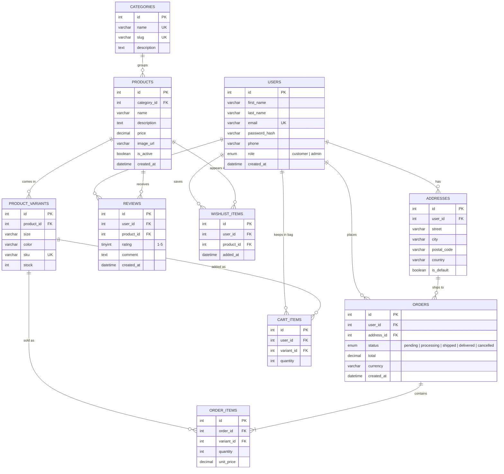

# Draft ERD: Varenne

Draft database plan for Milestone 1. GitHub renders the Mermaid diagram below automatically.
It can also be pasted into https://mermaid.live to export a PNG for submission.

## Entities

| Entity | Why it exists | Where it shows in the SPA |
|---|---|---|
| `users` | Customers and admins (role column) | `#login`, `#register`, `#profile` |
| `addresses` | A user can save several shipping addresses | `#profile` (Addresses), `#cart` (Checkout) |
| `categories` | Women, Men, Accessories | `#home`, `#shop` filters, `#dashboard` |
| `products` | The garment itself (name, price, description) | `#shop`, `#product`, `#dashboard` |
| `product_variants` | Size and colour combinations with their own stock | `#product` size/colour pickers |
| `cart_items` | The user's bag, stored server side | `#cart` |
| `wishlist_items` | Saved pieces | `#profile` (Wishlist) |
| `orders` | A placed order with status and total | `#profile` (Order history), `#dashboard` |
| `order_items` | Lines of an order; `unit_price` is copied so later price changes don't alter old orders | `#dashboard` |
| `reviews` | Ratings and comments on products | `#product` (Client reviews) |

## Notes

- `order_items.unit_price` is stored on purpose (price at the time of purchase).
- Stock lives on `product_variants`, not `products`, because each size has its own stock.
- `orders.currency` prepares for the external API feature (currency conversion via an exchange-rate API).
- Relationships: one-to-many everywhere; the many-to-many between users and products is resolved by `cart_items`, `wishlist_items` and `reviews`.
